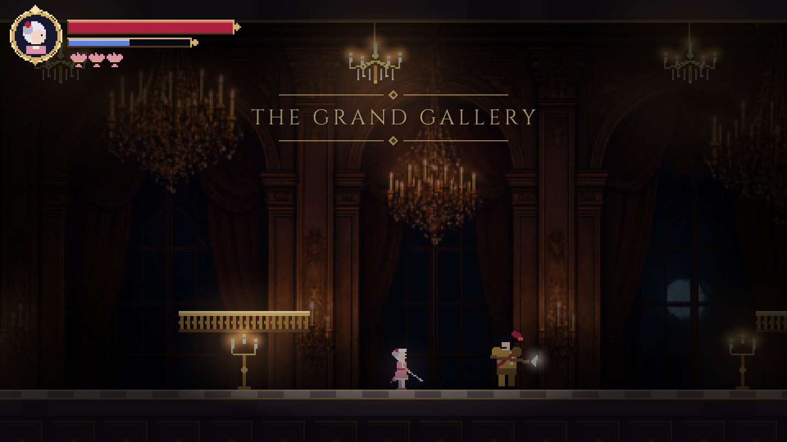
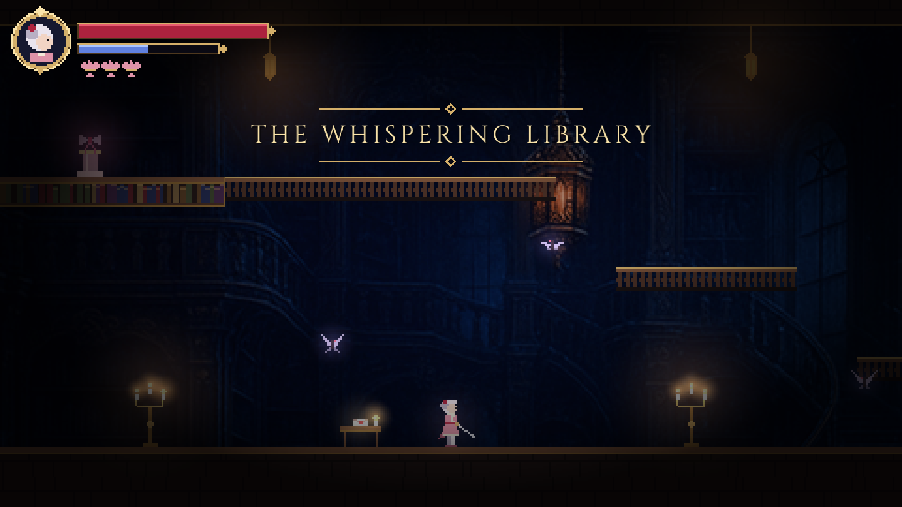
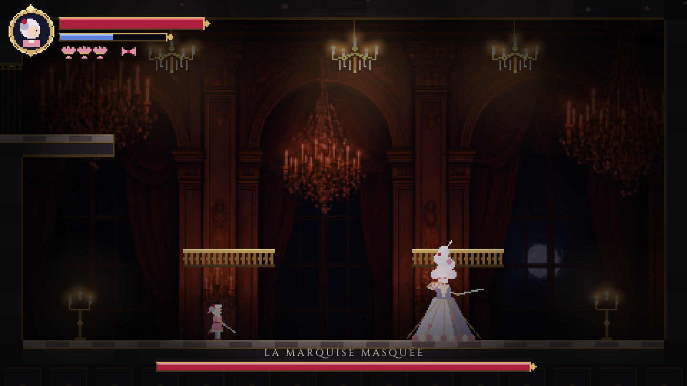

# Éclat — a metroidvania of shadows and silk

A small, playable rococo metroidvania fragment written in Rust with
[macroquad](https://macroquad.rs). Éloise, a rapier-wielding noblewoman in
rose silk, returns to a palace where the masque never ended.



## The fragment

Three connected rooms, one ability gate and a boss duel:

1. **The Grand Gallery** — a gilded ballroom patrolled by a halberdier. A
   high ledge on the right leads onward, but it's out of reach.
2. **The Whispering Library** — climb the balconies past the moths to find the
   *Silk Ribbon of the Comtesse* (double jump), and a letter that hints at how
   to read the Marquise.
3. **Hall of the Endless Masque** — return to the gallery, double-jump to the
   ledge, and duel **La Marquise Masquée**. She throws a boomerang fan, lunges
   with a rapier, and in her second phase adds a volley of thorns. Her eyes
   flare red before every attack.




## Controls

| Action             | Keys              |
|--------------------|-------------------|
| Move               | A / D, ← / →      |
| Jump (hold = higher) | Space, Z        |
| Drop through balcony | ↓ + Jump        |
| Rapier lunge       | J, X              |
| Petal dart (25 mana) | K, C            |
| Rosewater (heal)   | L, V              |
| Examine            | E, W, ↑           |
| Confirm            | Enter, Space      |
| Fullscreen         | F11               |

Lunge hits restore mana. Halberdiers can't be staggered mid-swing, so step
back from the wind-up glint and punish the recovery.

## Running

```sh
cargo run --release
```

On Linux you need an X11 session with OpenGL (macroquad loads `libGL`,
`libX11` and `libXi` at runtime). Audio is disabled, so ALSA isn't needed.

```sh
cargo test     # level-geometry and gameplay checks, headless
```

The tests check that a single jump can't reach the gallery ledge but a
double jump can, that the library balconies are climbable, that every exit
pairs with one back, that the Marquise can be defeated, and that a long
random-input session never panics.

For a headless screenshot of a named moment (`title`, `gallery`, `fight`,
`library`, `letter`, `relic`, `ledge`, `boss`, `victory`, `dead`):

```sh
xvfb-run -a -s "-screen 0 1440x810x24" cargo run --release -- --shot boss out.png
```

## How it's built

The game renders into a 480×270 render target that is scaled up by a whole
number with nearest-neighbour filtering. Text is drawn afterwards at full
window resolution so the lettering stays crisp.

| File | Contents |
|------|----------|
| `src/world.rs` | ASCII room maps (legend in the module docs), tile collision, exits |
| `src/player.rs` | Movement with coyote time, jump buffering and variable jump height; combat |
| `src/enemy.rs` | Halberdier, moth and Marquise AI |
| `src/game.rs` | Game state, combat resolution, room transitions, boss fight, particles, tests |
| `src/draw.rs` | Everything drawn from primitives: tiles, decor, characters, HUD, additive candle glow |
| `src/ui.rs` | Title, banners, letters, boss card, death and victory screens |

Everything except the two painted backdrops is drawn in code.

## Credits

- Backdrops in `assets/backdrops/` were generated with OpenAI's
  `gpt-image-1-mini`, then cropped to 16:9.
- [Cinzel](https://fonts.google.com/specimen/Cinzel) by Natanael Gama and
  [EB Garamond](https://fonts.google.com/specimen/EB+Garamond) by Georg Duffner
  and Octavio Pardo, both under the SIL Open Font License (see
  `assets/fonts/*-OFL.txt`).
